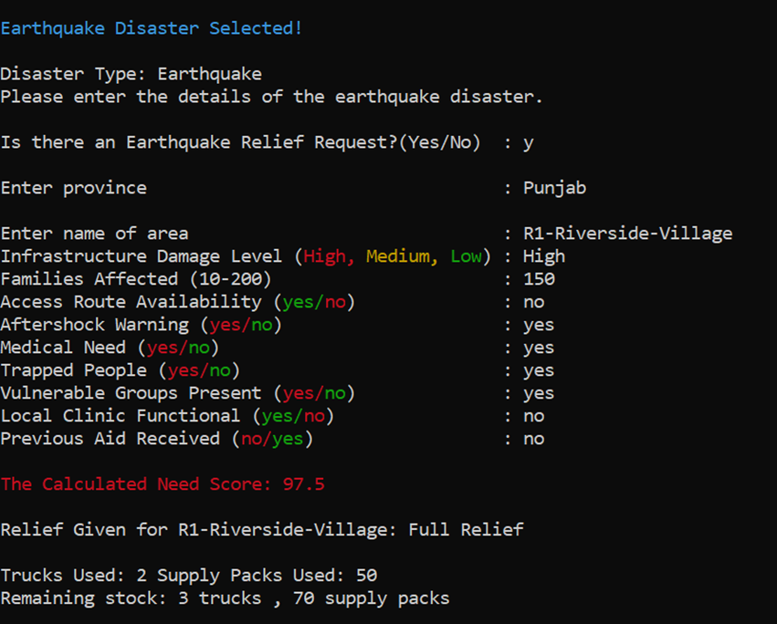
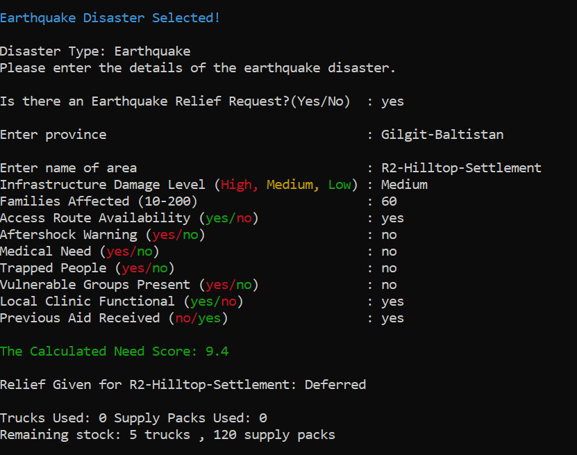
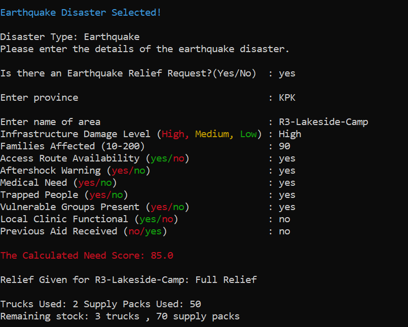
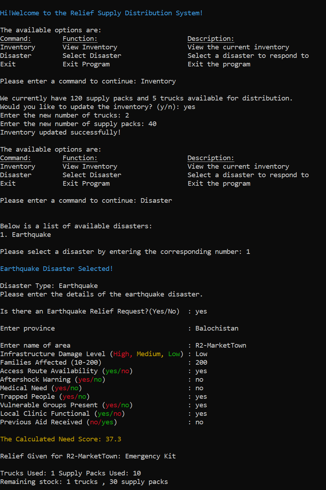
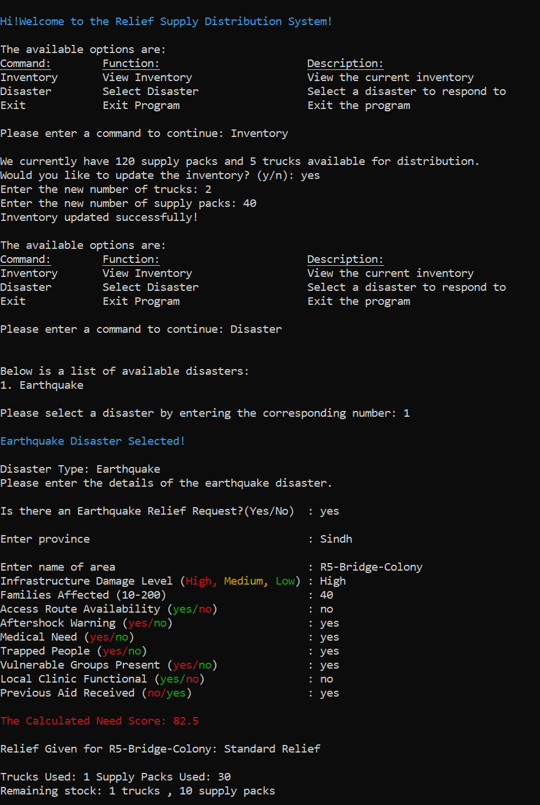

# Relief Supply Distribution System: Scoring Documentation

This program manages relief supply distribution in case of a natural disaster such as an earthquake. Starting stock: 5 trucks, 120 supply packs. This program uses the data about the disaster to assign a severity index and a need score. Then, the need score is used to allocate the relief supply.

[**GitHub Repository URL:**](https://github.com/The-Hacker-s-Den/FOCP-Assignment-1)[ https://github.com/The-Hacker-s-Den/FOCP-Assignment-1](https://github.com/The-Hacker-s-Den/FOCP-Assignment-1)

## 1. Formula

Every relief request is converted into one Need Score from 0 to 100. Three sub-scores feed it.

### 1.1 People points (P), maximum 100

P = F + 25 × Medical + 30 × Trapped + 15 × Vulnerable + 10 × ClinicDown

| Component | Points |
| --- | --- |
| Families affected (F): 10–50 / 51–100 / 101–150 / 151–200 | + 5 / 10 / 15 / 20 |
| Medical need (yes) | +25 |
| People trapped (yes) | +30 |
| Vulnerable groups present: children, elderly, disabled (yes) | +15 |
| Local clinic not working (no) | +10 |

### 1.2 Impact points (I), maximum 100

I = D + 40 × Aftershock

| Component | Points |
| --- | --- |
| Infrastructure damage (D): Low / Medium / High | 12 / 36 / 60 |
| Aftershock warning (yes) | 40 |

### 1.3 Complexity points (C), 0 or 100

•         A = 100 if the road is damaged.

•         A = 0 if the road is open.

### 1.4 Need Score (N)

N = (0.5 × People Points) + (0.4 × Impact Points) + (0.1 × Complexity Points)

If the area already received aid: N = N − 10.

Clamp N to the range 0–100. Round to 1 decimal place.

Category weights: People 50%, Impact 40%, Complexity 10%. Maximum N = 50 + 40 + 10 = 100.

### 1.5 Effective weight of each input in the final score

Category weights multiply the raw points. This table shows what each input is actually worth on the 0–100 scale.

| Input | Raw points | Points in final score |
| --- | --- | --- |
| People trapped | 30 (of People Points) | 15.0 |
| Medical need | 25 (of People Points) | 12.5 |
| Vulnerable groups present | 15 (of People Points) | 7.5 |
| Local clinic not working | 10 (of People Points) | 5.0 |
| Families affected (low to high bracket) | 5–20 (of People Points) | 2.5–10.0 |
| Infrastructure damage (Low / Medium / High) | 12 / 36 / 60 (of Impact Points) | 4.8 / 14.4 / 24.0 |
| Aftershock warning | 40 (of Impact Points) | 16.0 |
| Road damaged | 100 (of Complexity Points) | 10.0 |
| Prior aid received | −10 flat | −10.0 |

Totals: People inputs 15 + 12.5 + 7.5 + 5 + 10 = 50. Impact inputs 24 + 16 = 40. Complexity 10.

## 2. Rules

### 2.1 Input validation

•         Families affected: integer from 10 to 200.

•         Medical need, trapped people, vulnerable groups, clinic working, aftershock warning, road open, prior aid: yes or no.

•         Damage level: High, Medium or Low.

•         An invalid answer produces an error message and the same question is asked again. Scoring starts only when every answer is valid.

### 2.2 Package selection

| Need Score | Package | Trucks | Supply packs |
| --- | --- | --- | --- |
| 65 or more | Full Relief | 2 | 50 |
| 40 to 64.9 | Standard Relief | 1 | 30 |
| 20 to 39.9 | Emergency Kit | 1 | 10 |
| Below 20 | Defer / Monitor | 0 | 0 |

### 2.3 Dispatch and fallback

1.       Score below 20: mark the request Defer / Monitor. Send nothing. Stock is not checked.

2.       Otherwise select the package the score earned.

3.       Dispatch test: the package is sent only if trucks in stock ≥ trucks required AND supply packs in stock ≥ packs required. Both conditions must hold.

4.       If the test fails, step down one package and repeat step 3. Order: Full Relief → Standard Relief → Emergency Kit.

5.       If the Emergency Kit test fails, mark the request Deferred: not enough stock. Send nothing.

6.       On a successful dispatch, subtract the trucks and packs used from stock. Stock changes only on a successful dispatch.

7.       Stepping only goes down. A request is never upgraded above the package its score earned.

| Score band | Attempt order | Possible outcomes |
| --- | --- | --- |
| 65 or more | Full → Standard → Emergency | Full, Standard, Emergency, or Deferred: not enough stock |
| 40 to 64.9 | Standard → Emergency | Standard, Emergency, or Deferred: not enough stock |
| 20 to 39.9 | Emergency | Emergency, or Deferred: not enough stock |
| Below 20 | none | Defer / Monitor |

### 2.4 Two kinds of deferral

•         Defer / Monitor: the score is below 20. Deliberate decision. Happens regardless of stock.

•         Deferred: not enough stock: the score earned a package but stock cannot fund even the smallest one (1 truck, 10 packs). Supply gap, not a need judgement. Signals that restocking is required.

Both count as deferred in the summary.

### 2.5 Request loop and reporting

•         After each request the system shows the area, the action taken, trucks used, packs used and remaining stock.

•         Requests are processed in the order received. Stock is not reserved for later requests.

•         At the end of an earthquake the summary shows requests served, requests deferred, and trucks and packs remaining.

## 3. Sample Tests

The following sample tests were performed to test the program's processing of the requests and it's behavior when trucks and/or supply packs run out.

### 3.1 R1 – Riverside Village (Sufficient Resources)



### 3.2 R2 – Hilltop Settlement (Sufficient Resources)



### 3.3 R3 – Lakeside Camp (Sufficient Resources)



### 3.4 R4 – Market Town (Insufficient Resources)&#32;



### 3.5 R5 -Bridge  Colony(Insufficient Resources)



## 4. Rationale

The point values are design judgements by the project team. They are not statistically calibrated against historical disaster data. The reasons below justify why each input is in the model, its rank against the other inputs, and its size relative to the package thresholds.

### 4.1 Design principles

1.       People before logistics. Half of the score (50%) measures the condition of people.

2.       Condition before scale. A small area with entrapment must outrank a large area that is stable.

3.       Area-wide hazard is separate from person-level need. Hazards that affect everyone in the area, including responders, sit in Impact (40%).

4.       Delivery difficulty adjusts the response but does not measure suffering. Complexity carries the smallest weight (10%).

5.       Fairness across areas. An area that already received aid is deprioritised so stock reaches areas with nothing.

6.       Some help beats no help. When stock is short the system sends a smaller package instead of refusing.

### 4.2 Reason for every input weight

**Trapped people: 30 raw, 15.0 final. Highest person-level weight.** Survival of people trapped in collapsed structures falls steeply with time. Urban search and rescue operations are planned around the first 72 hours. A delay here is irreversible: a life lost cannot be recovered by later aid. Trapped people also indicate collapse and injury in the same area.

**Medical need: 25 raw, 12.5 final.** Untreated injuries such as bleeding, crush injuries, fractures and infection deteriorate within hours to days. A medical need turns delay into avoidable death and permanent disability. Ranked below entrapment because entrapment is the more time-critical of the two.

**Vulnerable groups present: 15 raw, 7.5 final.** Children, elderly people and people with disabilities have higher mortality in disasters and depend on others for evacuation, water, food and medication. They are often treated as priority groups. Weighted below trapped and medical because this input describes who is exposed, not an active life-threatening event.

**Local clinic not working: 10 raw, 5.0 final.** A working clinic absorbs part of the medical load locally. When it is down, the full load falls on external aid. Lowest of the four condition flags because it modifies the consequence of medical need and overlaps with it.

**Families affected: 5 / 10 / 15 / 20 raw, 2.5 to 10.0 final.** The number of families sets how much material is needed. Even the maximum bracket (20) is below every condition flag except clinic status and vulnerable groups, and below trapped (30) and medical (25), so a large stable area cannot outrank a small area with entrapment or injuries. Brackets are used instead of exact counts because early counts are estimates.

**Infrastructure damage: 12 / 36 / 60 raw (ratio 1 : 3 : 5), 4.8 / 14.4 / 24.0 final.** Damage drives shelter loss, loss of water and power, and the number of entrapments. Low damage means mostly habitable buildings. Medium means partial uninhabitability. High means collapse and mass displacement. The steps are not proportional: the jump from Low to Medium (24 raw) is larger than from Medium to High (24 raw) only in ratio terms (3× then 1.7×), reflecting that any real structural damage changes needs sharply. High damage is the largest single contribution to the final score (24.0) because it is the best area-wide proxy for severity when person-level facts are unknown.

**Aftershock warning: 40 raw (40% of Impact), 16.0 final.** Aftershocks can collapse already weakened buildings, injure survivors and endanger responders, and push people to stay outdoors, which raises shelter, water and warmth needs. It affects everyone in the area, so it sits in Impact and carries a high weight. An aftershock warning alone is enough to lift even a Low-damage, 10-family request out of Defer / Monitor (minimum score 23.3).

**Road damaged: 100 raw, 10.0 final.** A cut-off area cannot self-resupply, evacuate its injured or be reached by follow-up convoys, so relief must be sized for the delivery effort. The complexity weight is only 10% because road condition describes delivery difficulty, not human suffering. An accessible area with trapped people must outrank an unreachable area with no casualties. A damaged road alone, with no other risk factor, scores 17.3 and does not trigger relief.

**Prior aid received: −10 flat.** An area already served has had part of its initial need met. Limited stock should go first to areas with nothing. The deduction is a flat subtraction after the weighted sum, not a multiplier, so it lowers priority by roughly half a band without erasing severe need: any request with both trapped people and medical need still scores at least 24.8 after the penalty and receives at least an Emergency Kit when stock allows.

### 4.3 Reason for the package thresholds

•         Below 20: only 83 of 1,536 possible input combinations (5.4%) fall here. The cut-off removes requests with almost no risk factors and nothing else.

•         20 to 39.9, Emergency Kit: the smallest dispatch. Every dispatch needs at least one truck, so the truck is the minimum unit of response. 26.4% of combinations.

•         40 to 64.9, Standard Relief: covers the broad middle of requests. 49.5% of combinations.

•         65 and above, Full Relief: the only package that commits two trucks. With default stock it uses 40% of trucks and about 42% of packs, so it is reserved for the top 18.8% of combinations, where several severe factors combine.

### 4.4 Reason for the fallback to a smaller package

•         Stock is a hard limit. A request that earned Full Relief with stock for only Standard Relief still receives Standard Relief. Help arrives now instead of never.

•         Both trucks and packs are tested at every step, so the system finds the largest package the remaining stock can support. Stock is not left idle while an area waits.

•         Smaller packages stretch scarce stock over more areas.

•         The system never steps up. A larger package than the score earned would take stock from areas that have not yet reported.

•         The final failure is recorded as Deferred: not enough stock, separate from Defer / Monitor, so the operator can see a supply shortage as distinct from low need.

•         Stock is deducted only after a package is confirmed, so a failed attempt never leaves stock partly consumed.

## 5. Results

### 5.1 Capacity of the default stock

| Package | Limited by trucks | Limited by packs | Maximum dispatches |
| --- | --- | --- | --- |
| Full Relief | 5 ÷ 2 = 2 | 120 ÷ 50 = 2 | 2 |
| Standard Relief | 5 ÷ 1 = 5 | 120 ÷ 30 = 4 | 4 (Limited Packs) |
| Emergency Kit | 5 ÷ 1 = 5 | 120 ÷ 10 = 12 | 5 (Limited Trucks) |

Trucks are the scarce resource for Emergency Kits. Packs are the scarce resource for Standard Relief.

### 5.2 Verified behaviors of the scoring model

•         Trapped people, with no prior aid, score at least 22.3. The request always earns at least an Emergency Kit.

•         Trapped people plus medical need score at least 34.8, or 24.8 with prior aid. The request always earns at least an Emergency Kit.

•         An aftershock warning alone lifts a request to at least 23.3, above the Defer / Monitor line.

•         A damaged road alone, with no other risk factor, scores 17.3. It does not trigger relief by itself.

•         Limit: trapped people alone, combined with prior aid received, Low damage and 10 families, score 12.3 and are deferred as Defer / Monitor.


## Getting the project

### Clone the repository

```bash
git clone https://github.com/The-Hacker-s-Den/FOCP-Assignment-1.git
cd FOCP-Assignment-1
```

### Download the latest release

If you only want to run the app, you can download the latest release instead of cloning the source repository: [Latest release](https://github.com/The-Hacker-s-Den/FOCP-Assignment-1/releases/latest).

The relevant source files are included in the repository. Please refer to the files themselves for the assignment-specific instructions and implementation details.

## Authors

- **Shaheer Mirza** — [GitHub](https://github.com/Shaheer-Mirza)
- **rameen-debug** — [GitHub](https://github.com/rameen-debug)
- **Hania1573** — [GitHub](https://github.com/Hania1573)

## Contributors

<p align="center">
  <a href="https://github.com/Shaheer-Mirza">
    
  </a>
  <a href="https://github.com/rameen-debug">
    
  </a>
  <a href="https://github.com/Hania1573">
    
  </a>
</p>

## AI Use Note

AI was used for understanding assignment requirements, clarifying concepts, and researching ideas. The need-score approach was suggested by our group, while the province-based prediction feature was explored as an additional idea.
